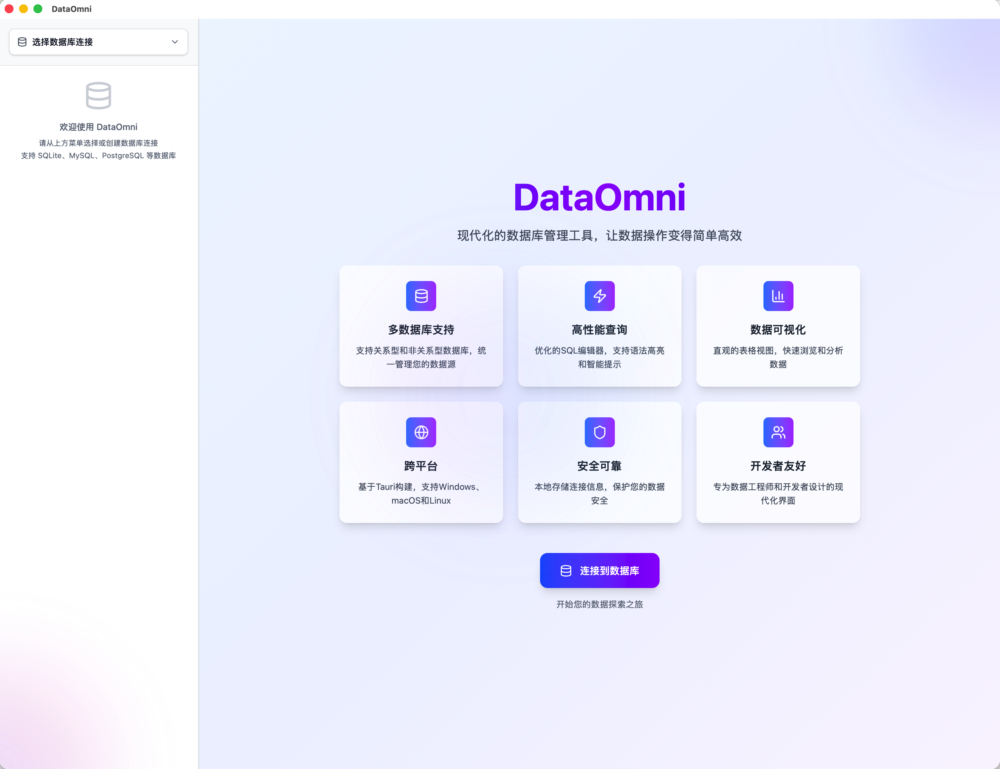

# DataOmni

**English** | [中文](README.md)

A desktop database client for relational databases, MongoDB, Redis, Neo4j and Elasticsearch,
built with Tauri 2, React and Rust. It runs on macOS, Windows and Linux, and the interface is
available in English and Chinese (the language switch is at the bottom of the sidebar).

<!-- screenshot: images/en/overview.png replaces the image below (docs/screenshots.md) -->


## Why DataOmni

- **One client for 14 kinds of servers.** MySQL, PostgreSQL, SQLite, SQL Server, Oracle, DuckDB and
  ClickHouse, plus MariaDB, TiDB, OceanBase, CockroachDB and openGauss through the compatible
  connection types. MongoDB, Redis, Neo4j and Elasticsearch each get their own workspace.
- **Every statement it sends is guarded.** Edits are queued, previewed as the exact SQL that will
  run, committed in one transaction, and each affected row count is checked. Destructive statements
  ask first, and the threshold depends on the connection's environment (production is stricter).
- **It shows what the database said.** Errors come with SQLSTATE, line and column, DETAIL, HINT,
  constraint and table names. A failed connection tells you which step broke: name resolution, a
  refused port, a port that accepts and drops the connection, or credentials.
- **Credentials stay in the system keychain** (macOS Keychain, Windows Credential Manager, Linux
  Secret Service). The configuration file only stores references.
- **Read-only access for AI agents.** `dataomni cli` lets Claude Code and similar agents query the
  connections you configured, read-only, without ever seeing a password.

## Compatibility

Every row below comes from smoke tests run against a real server (`src-tauri/tests/*_smoke.rs`),
not from protocol compatibility on paper. The last full run was on 2026-10-16. The
[Chinese README](README.md#兼容性矩阵) lists the known gaps of each server in detail.

| Server | Version | Connection type | Status |
| --- | --- | --- | --- |
| MySQL | 8.4 | MySQL | ✅ Supported |
| MySQL | 5.7.44 | MySQL | ⚠️ Usable, with gaps (TLS must be disabled; no `RENAME COLUMN`, renames restate the column) |
| PostgreSQL | 16 | PostgreSQL | ✅ Supported |
| SQLite | bundled | SQLite | ✅ Supported |
| MariaDB | 11.4 | MySQL | ✅ Supported |
| TiDB | 8.5 | MySQL | ✅ Supported |
| OceanBase | 4.4.2 CE, MySQL mode | MySQL | ⚠️ Usable, with gaps |
| CockroachDB | 25.2 | PostgreSQL | ⚠️ Usable, with gaps |
| openGauss | 5.0.3 | PostgreSQL | ⚠️ Usable, with gaps (sha256-password users supported) |
| SQL Server | 2022 | SQL Server | ✅ Supported |
| Oracle | 23ai Free | Oracle (Instant Client bundled) | ✅ Supported (service name or SID; TLS needs a wallet and is not supported, use an SSH tunnel) |
| DuckDB | 2.0.0, built in | DuckDB | ✅ Supported |
| ClickHouse | 25.8 | ClickHouse (HTTP) | ⚠️ Edits one row at a time, no transactions |
| MongoDB | 8.0 | MongoDB | ⚠️ Document-level, with gaps (no `db.coll.find()` JavaScript syntax) |
| Redis | 7.4 | Redis | ✅ Standalone, Sentinel and Cluster |
| Neo4j | 5.26 LTS, 2026.09 | Neo4j (Bolt) | ⚠️ Single instance; cluster routing only tested against a single instance |
| Elasticsearch | 8.19, 9.5 | HTTP | ⚠️ Single-node direct connection |
| OpenSearch | 3.8 | Elasticsearch | ⚠️ Single-node direct connection; no API key |

## Features

### Queries

- SQL editor with dialect-aware statement splitting (strings, comments and dollar-quoted bodies
  are handled), formatting, and completion from the live schema: tables, views and their columns,
  aliases (`FROM orders o` then `o.`), and keywords filtered by dialect.
- Timeouts and cancellation that stop the statement on the server, not just on the client.
- Results are capped by a row limit and streamed in batches. Several result sets per statement
  (`EXEC`, `CALL`) are shown one by one.
- Execution plans for each database, parsed into one expandable tree. PostgreSQL and SQL Server can
  run the statement for real and show actual rows and timings per step. The step whose estimate is
  off by an order of magnitude or more is pointed out.
- History records time, connection, statement, duration, status and affected rows, never result
  rows. Passwords in statements are replaced with `'***'` before they are written.
- Save a tab as a `.sql` file, open `.sql` files, and keep drafts across restarts.

<!-- screenshot: images/en/query.png (docs/screenshots.md) -->

### Browsing and editing data

- Server-side paging with stable ordering; sorting and filtering run in the database against the
  whole table.
- NULL, empty strings, whitespace-only values and binary values look different in the grid.
- Rows are located by a real primary key or a qualifying unique index. A query result is editable
  only when it can be proven to map to unique rows of one table; otherwise it is read-only and the
  reason is shown.
- Edits, inserts and deletes go into a pending queue. Preview the exact statements, undo items one
  by one, then commit them in one transaction. Original values are part of the `WHERE` clause, so a
  concurrent change makes the save fail instead of being silently overwritten.
- Structure editing (rename, type, nullability, default, add and drop columns, rename tables) and
  creating tables, indexes and schemas. Every change is previewed as SQL first, with what would be
  lost and which steps the dialect cannot do.
- Export results or whole tables to CSV, JSON or `INSERT` statements, streamed to disk with progress
  and cancellation. CSV import with a three-step wizard (delimiter and encoding detection, including
  GB18030), column mapping and failed rows reported by file line number.
- Backups through the native tools: `VACUUM INTO` for SQLite, `EXPORT DATABASE` for DuckDB, and the
  local `pg_dump`, `mysqldump` and `mongodump`.
- ER diagram of a whole database: search, filter by schema or by distance from a table, export to
  SVG, PNG or PDF, or to a data dictionary (Markdown) and an Agent Skill (`SKILL.md`).
- Code generation from the ER diagram (or an AI design): a Prisma schema, TypeORM or MikroORM entities
  (for NestJS), SeaORM entities, or sqlx `FromRow` structs. It is deterministic, without AI. Types it
  cannot map and tables it cannot generate are listed at the top.
- Schema compare: diff tables, columns, primary keys, indexes and foreign keys against another
  connection, tick what to sync, and get a script that makes the target match. The script opens in the
  editor and runs through the usual per-environment confirmation; across different kinds of database you
  get the report only.
- Bind parameters: write `:name` in the editor and fill in the values before the statement runs. The
  driver binds them, so nothing is pasted into the SQL and text needs no quotes. Not yet for ClickHouse
  or the execution plan.
- Quick bar and line charts of the current result.

<!-- screenshot: images/en/table-edit.png (docs/screenshots.md) -->
<!-- screenshot: images/en/er-diagram.png (docs/screenshots.md) -->

### MongoDB, Redis, Neo4j and Elasticsearch

- **MongoDB**: databases, collections and views; filter, sort and edit documents in mongosh syntax;
  bulk update and delete by filter; aggregation pipelines; indexes and validation rules; import and
  export in mongoexport format; a `db.runCommand` console. SRV (Atlas), TLS, client certificates and
  X.509 authentication are supported.
- **Redis**: databases with keys, `SCAN`-based key browsing by pattern and type, viewers and editors
  for string, hash, list, set, sorted set and stream values. Python pickle and JSON values are decoded
  and highlighted. A console with redis-cli syntax and output. Sentinel and Cluster are supported.
- **Neo4j**: labels and relationship types, a Cypher editor, results drawn as a graph, and editing
  nodes and relationships (properties, labels, creating and deleting). `EXPLAIN` and `PROFILE` plans.
- **Elasticsearch / OpenSearch**: indices, aliases and data streams, a console in Kibana Dev Tools
  syntax, tables for hits, ES|QL / SQL results and aggregations, a mapping viewer, and editing or
  deleting single documents with optimistic concurrency.

<!-- screenshot: images/en/mongodb.png (docs/screenshots.md) -->
<!-- screenshot: images/en/redis.png (docs/screenshots.md) -->

### Connections and security

- TLS modes from "disable" to "verify hostname", with CA and client certificates.
- SSH tunnels with keys (passphrase-protected keys too) or passwords. Host keys are checked against
  `~/.ssh/known_hosts`; there is no "skip verification" switch.
- Each connection is marked as development, testing, staging or production and shows a text badge
  (DEV, TEST, STAGING, PROD), not only a color.
- Export connections to a JSON file (without passwords or SSH keys) and import them elsewhere.

### AI (optional, off by default)

- Design new tables from a one-line description: the model returns a multi-table design, which is
  validated, drawn as an ER diagram, previewed as `CREATE TABLE` statements and only then executed.
  The model never writes SQL that gets executed; DataOmni generates the statements itself.
- Two interface types cover most providers: Anthropic and OpenAI-compatible (DeepSeek, Qwen, Zhipu,
  Kimi, a local Ollama, and others). Only the request, existing table names and the current design
  are sent, never data. API keys are stored in the system keychain.
- Builds without AI: `bun tauri build -- --no-default-features` leaves the code that talks to model
  services out of the binary.

### Command line and agents

`dataomni cli` gives terminals and AI agents read-only access to the connections you configured in
the app. Passwords are never handed to the caller.

- Access is opt-in per connection (connection form → "Command line & agent access": off or
  read-only; off by default). Production connections are never visible, and no command-line flag changes that.
- Relational databases: `query`, `explain`, `schema`, `ddl`, `dictionary`, `export`, `backup` and
  `test`. Only a single read statement is accepted, and it runs inside the database's own read-only
  transaction, ending in a rollback.
- MongoDB, Redis, Neo4j and Elasticsearch each have read-only commands. For example, Redis only runs
  commands the server itself flags as `readonly`.
- Output is JSON, and exit codes distinguish database errors, bad arguments, refusals and
  connection failures. `dataomni cli guide` prints instructions written for agents; save it as
  `SKILL.md` to use it as a Claude Code skill.
- Agents that cannot run a shell (Claude Desktop and the like) can use `dataomni mcp`, the same
  read-only commands served as an MCP server over stdio, behind the same access rules. `export`,
  `backup` and `csv-preview` are left out because they read or write local files. Example:
  `claude mcp add dataomni -- /Applications/DataOmni.app/Contents/MacOS/dataomni mcp`.

The real boundary is still a read-only database account: the app blocks writes, but not
administrative functions such as `pg_terminate_backend`.

## Install

Download a package from [Releases](https://github.com/yuxuetr/DataOmni/releases):

| Platform | Package |
| --- | --- |
| macOS (Apple Silicon) | `DataOmni_<version>_aarch64.dmg` |
| Windows (x64) | `DataOmni_<version>_x64-setup.exe` or `DataOmni_<version>_x64_en-US.msi` |
| Linux (x64, glibc 2.34+) | `DataOmni_<version>_amd64.deb` or `DataOmni-<version>-1.x86_64.rpm` |

The packages are **not signed** (there is no Apple Developer ID or Windows code-signing certificate
yet), so the first launch needs one extra step:

- **macOS**: the first open is blocked. Click "Open Anyway" at the bottom of System Settings →
  Privacy & Security, or run `xattr -dr com.apple.quarantine /Applications/DataOmni.app`.
- **Windows**: when SmartScreen says "Windows protected your PC", click "More info" → "Run anyway".
- **Linux**: `sudo apt install ./DataOmni_*.deb` or `sudo dnf install ./DataOmni-*.rpm`. Saving
  passwords needs an unlocked Secret Service (gnome-keyring on GNOME).

The Oracle Instant Client (Basic Light) is bundled, so Oracle works without installing anything.
macOS on Intel is not built yet. On Windows on ARM, the x64 package runs under emulation.

The app checks for new versions and tells you when one is out; it does not install updates by
itself.

## Build from source

Requirements: Rust, [Bun](https://bun.sh), and on Linux the Tauri system dependencies:

```bash
sudo apt-get install build-essential curl wget file pkg-config libssl-dev \
  libwebkit2gtk-4.1-dev libxdo-dev libayatana-appindicator3-dev librsvg2-dev xdg-utils
```

```bash
git clone https://github.com/yuxuetr/DataOmni.git
cd DataOmni
bun install

bun tauri dev      # development
bun tauri build    # release build
bun run check      # lint, typecheck, frontend tests, cargo fmt / clippy / tests
```

## Documentation

- [User manual](docs/user-manual.md) (Chinese): connections, the editor, transactions, plans,
  editing data and structure, import and export, ER diagrams, history, settings and shortcuts.
- [Command-line interface design](rfcs/agent-cli.md) (Chinese).
- Changelog: see the "更新日志" section of the [Chinese README](README.md#-更新日志).

## Contributing

Issues and pull requests are welcome: [Issues](https://github.com/yuxuetr/DataOmni/issues).
Run `bun run check` before opening a pull request.

## License

[MIT](LICENSE)
